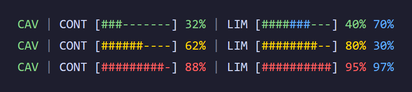

# Claude Statusline

Colorful Claude Code status line showing caveman state, context usage and 5-hour/weekly rate limits



## Features

- Shows context window usage as a 10-block bar, colored green, yellow or red by threshold.
- Shows the 5-hour rate limit as a bar, with the weekly limit drawn in blue on the same bar.
- Shows the state of the caveman plugin: green = active, orange = disabled, red = not installed.
- Falls back to dimmed empty bars when the data is missing or the JSON is invalid.
- Runs in about 50 ms per refresh (Node), versus about 240-460 ms for PowerShell.
- Works with several accounts by reading `CLAUDE_CONFIG_DIR`.

## Tech stack

- Node.js: the status line script (`token-usage-statusline.js`)
- PowerShell 5.1 / 7+: the installer, plus a reference port with identical output (`token-usage-statusline.ps1`)

## Getting started

### Prerequisites

- Node.js on the `PATH`
- Windows PowerShell 5.1 or PowerShell 7+
- Claude Code

### Install

```sh
git clone https://github.com/joao-carmassi/claude-statusline.git
cd claude-statusline
powershell -ExecutionPolicy Bypass -File install-claude-statusline.ps1
```

The installer uses `$env:CLAUDE_CONFIG_DIR` (or `~/.claude`), writes `hooks/token-usage-statusline.js` there, and merges a `statusLine` key into `settings.json` without touching the rest (a `settings.json.bak` is kept). Then open a new Claude Code session.

## Usage

Claude Code runs the command every 5 seconds and pipes a JSON object to stdin. The script reads `context_window.used_percentage`, `rate_limits.five_hour.used_percentage` and `rate_limits.seven_day.used_percentage`, then prints one ANSI-colored line. Try it by hand:

```sh
echo '{"context_window":{"used_percentage":32},"rate_limits":{"five_hour":{"used_percentage":40},"seven_day":{"used_percentage":70}}}' | node token-usage-statusline.js
```

| Segment | Meaning |
|---|---|
| `CAV` | Caveman plugin state: green = active, orange = disabled, red = not installed |
| `CONT` | Context window usage |
| `LIM` | 5-hour limit (bar and first %) and weekly limit (blue part and second %) |

## Configuration

The installer writes this `statusLine` entry:

```json
"statusLine": {
  "type": "command",
  "command": "node \"<folder>\\hooks\\token-usage-statusline.js\"",
  "refreshInterval": 5
}
```

Bars are 10 blocks, each worth 10%. Filled and empty blocks share the bar color.

| Bar | Green | Yellow | Red |
|---|---|---|---|
| `CONT` | below 50% | 50% to 74% | 75% or more |
| `LIM` (5h) | below 75% | 75% to 89% | 90% or more |

The weekly part of `LIM` is always blue. With no data the bar is dimmed: `[----------] --%`.

To share one script between accounts (for example `~/.claude` and `~/.claude-qf`), point both `command` entries at the same `.js`; it reads `CLAUDE_CONFIG_DIR` to know which account is running.

To undo, restore `settings.json.bak`, or switch `command` back to the PowerShell version:

```json
"command": "powershell -ExecutionPolicy Bypass -File \"<folder>\\hooks\\token-usage-statusline.ps1\""
```

## License

No license specified.

---
Made by [João Carmassi](https://github.com/joao-carmassi)
